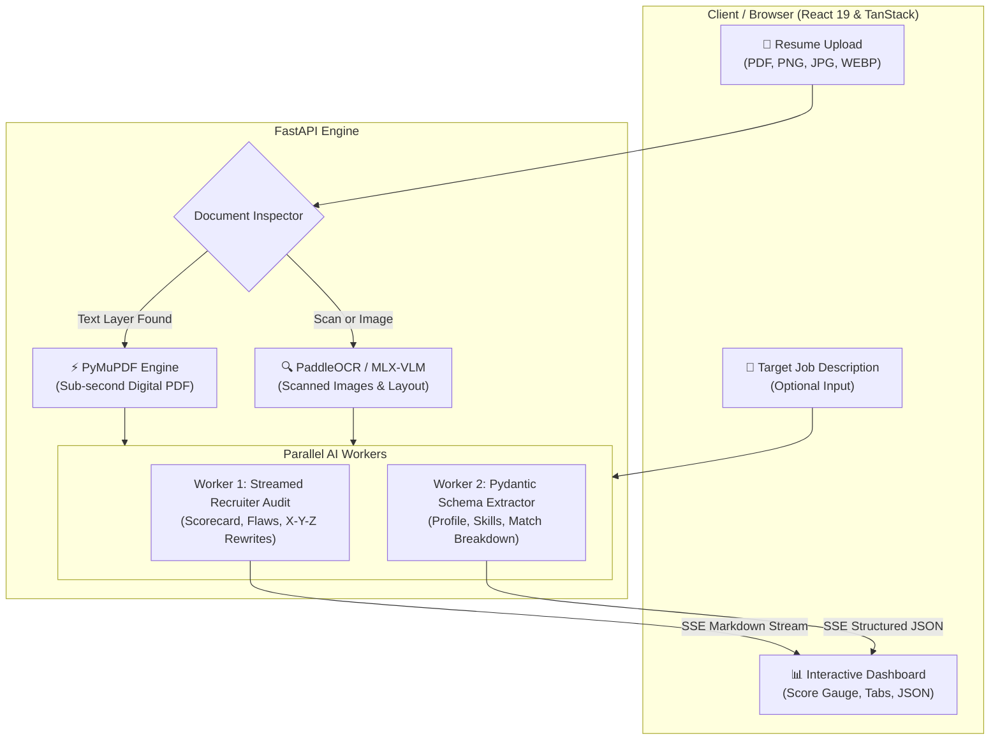

# 📄🤖 AI Resume Parser

An end-to-end full-stack application built for intelligent resume parsing and ATS (Applicant Tracking System) intelligence. Featuring a high-speed hybrid extraction pipeline (PyMuPDF for instant digital PDFs + local VLM for scanned documents), real-time recruiter audit streaming, target job description keyword matching, and structured Pydantic JSON profile extraction.

## 🏗️ System Architecture



## 🔄 Data Flow Workflow

1. **Upload & Ingestion** — User uploads a resume (PDF/PNG/JPG/WEBP) with an optional Target Job Description.
2. **Hybrid Document Extraction** — 
   - Digital PDFs are parsed instantaneously via `PyMuPDF` (`fitz`), preserving text and layout with zero GPU dependency.
   - Scanned PDFs or image files seamlessly route to platform-optimized local Vision-Language Models (`mlx-vlm` on Apple Silicon or `PaddleOCRVL` on Windows).
   - Temporary upload files are purged immediately post-extraction.
3. **Dual AI Pipeline (Parallel Workers)** —
   - **Worker 1**: Streams real-time ATS critique (Score breakdown, Structural & Formatting Flaws, and Google X-Y-Z bullet rewrites) via Server-Sent Events (SSE).
   - **Worker 2**: Concurrently extracts validated Pydantic JSON (`CandidateProfile` & `ATSScoreBreakdown`) and multiplexes it onto the stream as a structured event.
4. **Interactive ATS Dashboard** — Displays an animated circular ATS Score Gauge, sub-metric evaluators (Parseability, Formatting Safety, Metric Impact), Matched vs. Missing Skill Gap pills, and a 4-tab results viewer with one-click JSON download.

## 🛠️ Tech Stack

| Domain | Technologies |
|---|---|
| Frontend | React 19, TanStack Start & Router, Tailwind CSS v4, Biome, Lucide & Tabler Icons |
| Backend | Python 3.12, FastAPI, Uvicorn, PyMuPDF (fitz), Pydantic v2 |
| OCR / VLM Engines | **macOS (Apple Silicon):** MLX-VLM (Local fallback)<br>**Windows (NVIDIA GPU):** PaddleOCR, PaddlePaddle GPU |
| AI Integrations | OpenRouter API (`openrouter/free` or customizable LLMs via OpenAI AsyncClient) |

## ⚡ Key Features

- **Hybrid Document Ingestion** — Lightning-fast digital PDF text extraction with automatic fallback to local VLM for scanned documents and images.
- **Visual ATS Score Gauge** — Circular SVG score ring (0–100) with rating badges and sub-metric breakdown (Parseability, Formatting Safety, Metric Impact, Keyword Relevance).
- **Target Job Description Matcher** — Evaluates tailored skill alignment, highlights matched vs. missing qualifications, and calculates role match percentage.
- **Actionable Google X-Y-Z Rewrites** — Automatically refactors bullets into high-impact accomplishments: *"Accomplished [X] as measured by [Y], by doing [Z]"*.
- **Structured Data Export** — Validated Pydantic schema extraction (Skills, Work Experience, Education, Contact Info) with one-click Copy JSON and Download JSON.

## 📁 Repository Structure

```
.
├── src-backend/          # FastAPI server & AI model execution engines
│   ├── routes/          # API endpoint routes
│   ├── main.py          # FastAPI application entry point
│   └── requirements.txt # Standard Python dependencies
└── src/                 # TanStack web application frontend
```

## 🚀 Getting Started

### Prerequisites

- **Node.js:** v18.0.0 or higher (pnpm recommended)
- **Python:** v3.12.*
- **OpenRouter API Key:** Obtainable from OpenRouter.ai
- **Hardware Requirements:**
  - Windows: NVIDIA GPU with CUDA 12.x drivers installed.
  - macOS: Apple Silicon (M1/M2/M3/M4) running macOS Monterey or later.

### 1. Environment Setup

Create a `.env` file in the root directory:

```
OPENROUTER_API_KEY=your_openrouter_api_key_here
```

### 2. Backend Installation

Navigate to the backend directory and set up a Python virtual environment:

```bash
cd src-backend
python -m venv venv

# Activate on Windows:
.\venv\Scripts\activate

# Activate on macOS/Linux:
source venv/bin/activate

# Install core dependencies
pip install -r requirements.txt
```

### ⚠️ Platform-Specific AI Extensions

Run one of the following setups based on your operating platform:

**Option A: Windows (NVIDIA GPU / CUDA 12.x)**

```bash
# Install CUDA-enabled PaddlePaddle GPU engine
python -m pip install paddlepaddle-gpu==3.2.1 -i https://www.paddlepaddle.org.cn/packages/stable/cu129/

# Install PaddleOCR with document parsing extensions
python -m pip install -U "paddleocr[doc-parser]"

# Install GenAI server dependencies (vLLM inference acceleration)
paddleocr install_genai_server_deps vllm
```

**Option B: macOS (Apple Silicon)**

```bash
# Install MLX Vision-Language Model framework optimized for Metal GPUs
pip install "mlx-vlm>=0.3.11"
```

## 3. Application Launch

Once the required dependencies are installed, you can continue with the following instructions.

### Go to root project directory
```bash
# Start app on Windows
npm run dev:windows

# Start app on MacOS
npm run dev:macos
```

## 🤝 Contributing

Contributions, feature suggestions, and pull requests are welcome! If you find bugs or want to experiment with alternative VLM backends, feel free to open an issue or submit a PR.